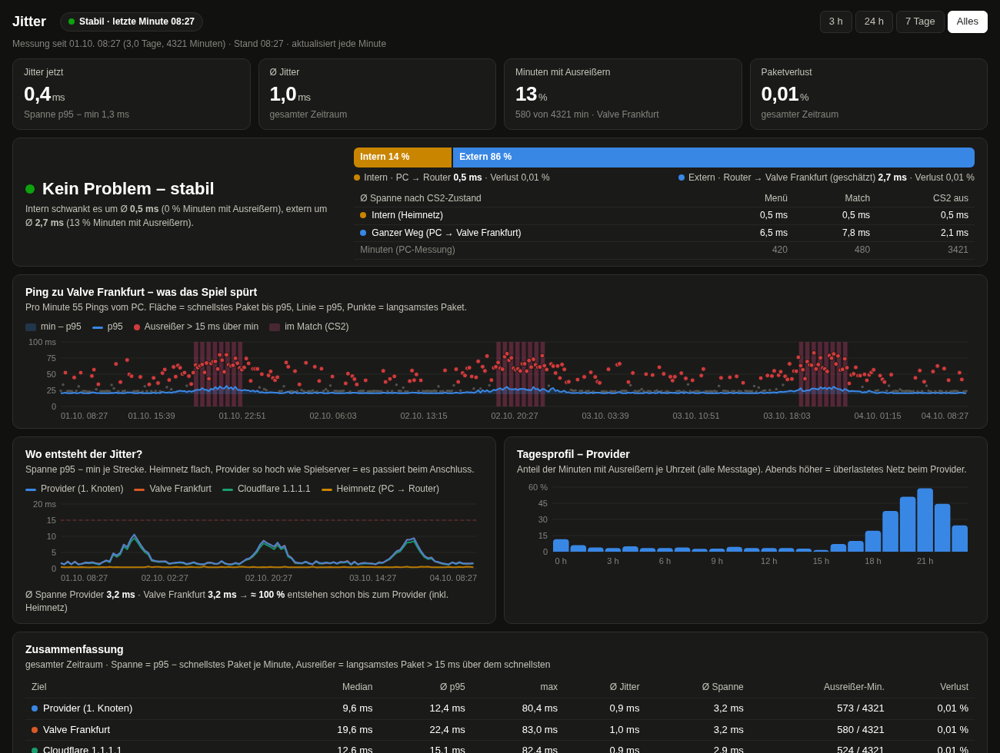

<div align="center">


# omarchy-jitter

**Find out where your in-game lag spikes come from: your Wi-Fi, your provider or the game server.**
A bar widget and a window for [Omarchy](https://omarchy.org) / Hyprland. It pings every minute and keeps the history.

[](https://omarchy.org)
[](#what-it-shows)
[](LICENSE)
[](README.de.md)



</div>

---

## What it shows

A good average ping can still feel bad when it jumps around. That is **jitter**.
Every minute, `jitterlog` sends 55 pings to each of these targets and saves the fastest, median, p95 and slowest reply:

| Target | Path | Tells you |
|---|---|---|
| 🏠 **Home network** | PC → router | Wi-Fi or LAN problems |
| 🌐 **Provider** | first hop at your ISP | problems with your internet line (e.g. a busy cable segment in the evening) |
| 🎮 **Game server** | Valve Frankfurt by default | the whole path, as the game feels it |
| ☁️ **Cloudflare** | 1.1.1.1 | cross-check |

- **Bar:** jitter to the game server in the last minute, red when it spikes (> 15 ms above the fastest packet) or packets get lost
- **Panel:** 3 h chart, last hour per target, hour-of-day profile
- **Window** (button *Fenster* / middle click / launcher "Jitter"):
  - *Internal or external?* verdict with the share of each side
  - Game server chart with CS2 match minutes marked
  - Spread comparison of all targets, hour-of-day profile, summary table
  - Ranges 3 h / 24 h / 7 days / all
- The UI is in German.

## Install

```bash
omarchy plugin add https://github.com/vsvito420/omarchy-jitter.git --enable
~/.config/omarchy/plugins/vsvito.jitter/install.sh
```

`install.sh` asks a few questions and then sets up:

- the config in `~/.config/jitterlog/config` (only on your machine, `chmod 600`)
- the commands `jitterlog`, `jitterlog-status`, `jitterlog-sync` and `jitter-app` in `~/.local/bin`
- the systemd user service `jitterlog.service`, which measures every minute
- the launcher "Jitter"
- the CS2 Game State Integration, if CS2 is installed (marks menu and match minutes; restart CS2 once)

Remove it with `install.sh --remove` and the widget with `omarchy plugin remove vsvito.jitter`.
Your config and data in `~/.local/state/jitterlog/` stay.

## Config

```bash
ROUTER=                    # optional, see below
ROUTER_PORT=22
GAME_HOST=155.133.226.68   # Valve relay Frankfurt – use the server you play on
GAME_NAME="Valve Frankfurt"
ISP_HOST=                  # empty = found automatically (first public hop)
```

### Optional: let the router measure too

From the PC, every path goes through your Wi-Fi, so internal and external can only be estimated.
If your router has SSH, cron and a persistent `/jffs` (e.g. ASUS stock or Merlin firmware), set `ROUTER=user@router-ip`.
`jitterlog-sync` then copies [`router/jitterlog.sh`](router/jitterlog.sh) to the router, adds a `cru` job and pulls the results every hour.
The router pings provider, game server and Cloudflare without Wi-Fi in between, which gives an exact split.

## How it works

- **Measuring:** [`bin/jitterlog`](bin/jitterlog) runs as a user service and writes one CSV line per target and minute to `~/.local/state/jitterlog/pc-YYYY-MM.csv`
  (`zeit,ziel,ip,gesendet,empfangen,min,median,p95,max,jitter`). It also listens on `127.0.0.1:3010` for CS2's Game State Integration.
- **Widget:** [`Jitter.qml`](Jitter.qml) runs [`bin/jitterlog-status`](bin/jitterlog-status) every minute, which sums things up in `widget.json`.
- **Window:** [`bin/jitter-app`](bin/jitter-app) starts a small server on `127.0.0.1:8766` and opens it as an Omarchy web app. It quits by itself 45 s after you close the window.
- **Spread** = p95 − fastest packet per minute. That is how much the delay moves, which is what you feel in game.
- Minutes where a reply takes over a second count as lost packets, not as jitter, so one Wi-Fi reconnect doesn't wreck the averages.

> [!TIP]
> The CSV files are plain text. After a few days, the hour-of-day profile is good evidence for your provider's support:
> if the provider hop spikes every evening while your home network stays flat, the problem is on their side.

## Requirements

- Omarchy with the Quickshell based shell (bar widgets via `~/.config/omarchy/plugins/`)
- Python 3, `ping` (iputils), `ip` (iproute2)

## License

[MIT](LICENSE) © 2026 vsvito420
